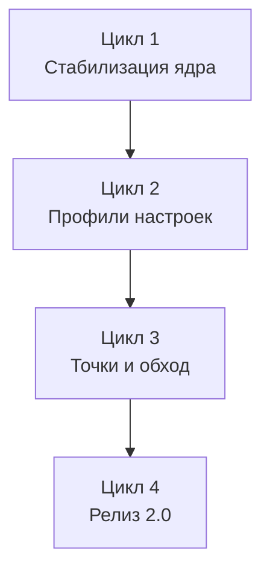

# Пара 2
## Практическая работа 2

## Проект

**AutoClicker Pro** - автокликер для Windows на C#/WPF (.NET Framework 4.7.2): <https://github.com/AlexMDLL/AutoClicker>

Три режима клика (обычный, фоновый через `PostMessage` в выбранное окно, игровой), цель в виде зоны, точки или окна, точный интервал от 1 мс в отдельном потоке, лимиты и рандомизация, статистика, 9 тем, горячие клавиши, три раскладки интерфейса, RU/EN, сборка в один `.exe`
Проект личный и учебный: разработчик один - эт я, релизы на GitHub под MIT, работа продолжается

## Анализ требований

- **Насколько понятны требования?** Основа понятна - клики с заданным интервалом по цели. Но требования не окончательные: турбо-режим, раскладки и свой пикер цвета появились уже по ходу работы
- **Может ли заказчик их менять?** Может, и это нормально: заказчик - сам автор(я) и пользователи GitHubа. Пересогласовывать ТЗ не нужно
- **Делится ли продукт на части?** Да, и почти независимые: ядро кликера, цель, режимы, таймер и лимиты, темы, горячие клавиши, локализация, статистика
- **Нужны ли промежуточные показы?** Нужны, это удобно: результат - готовый `.exe`, показать его легко.
- **Критичны ли сроки?** Не критичны, важнее стабильность сборки и отсутствие регрессий от версии к версии.

## Сравнение моделей

| Модель | Как бы работала команда | Плюсы | Минусы |
|---|---|---|---|
| **Waterfall** | Полное ТЗ на все функции → архитектура → весь код → тестирование → один релиз в конце | Ясный план и смета, архитектура продумана целиком | Требования к интерфейсу заранее не зафиксировать, любая идея тянет переработку ТЗ; первая версия - через месяц и более |
| **Итерационная** | Выпуск 1.0 с базой, дальше циклы «улучшить → проверить → оценить»: интерфейс, точность таймера, стабильность | Обратная связь после каждой версии, баги ловятся рано, качество растёт постепенно | Нет границы «готово», риск улучшать бесконечно |
| **Инкрементальная** | Список функций фиксируется, делаем по одной: ядро → цель → режимы → хоткеи → темы → локализация | После каждого шага есть рабочая версия, объём легко планировать | Без обратной связи легко сделать не то; архитектуру под будущие части надо продумать сразу |
| **Agile** | Бэклог идей, циклы по 1–2 недели, в конце - сборка, тест и новые приоритеты | План подстраивается под реальные нужды, ранние релизы, меньше лишней работы | Нужна дисциплина: бэклог, тесты, фиксированный объём цикла |

## Выбранная модель

**Agile** - короткие циклы с обратной связью, внутри которых функциональность наращивается инкрементами

Почему так
1. **Требования уточняются по ходу** - идеи приходят от версии к версии, а каскад требует зафиксировать всё заранее
2. **Разработчик один** - длинная фаза проектирования не по карману, цикл «идея → код → сборка → проверка» дешевле
3. **Каждый цикл заканчивается рабочим `.exe`** - то есть сразу приносит пользователю новую возможность
4. **Есть живая обратная связь** (issues, отзывы), и реагировать на неё удобнее короткими циклами

**Ограничения.** Формальные роли Scrum и тяжёлая документация не нужны. Главный риск - расползание объёма, поэтому цикл ограничиваю списком задач. Доработки могут ломать старое, поэтому перед каждым релизом - тест

## План разработки

Четыре цикла; в каждом сначала добавляется функциональный блок (инкремент), потом он же доводится итерациями

| Цикл | Что делаем | Результат |
|---|---|---|
| **1. Стабилизация ядра** | Точный таймер и лимиты, исправление ошибок, автосохранение и миграция настроек | Версия 1.1: 30 минут кликов без сбоев и роста памяти |
| **2. Профили настроек** | Несколько наборов настроек (цель, интервал, режим, кнопка), переключение и хоткей на профиль | Версия 1.2: переключение между сценариями в один клик |
| **3. Точки и обход** | Список точек в зоне, порядок обхода, паузы и задержка для каждой | Версия 1.3: сценарии из последовательности кликов |
| **4. Упаковка** | Подпись `.exe`, portable-сборка и установщик, сборка через GitHub Actions, документация | Релиз 2.0 без предупреждений SmartScreen |

**Проверка** в каждом цикле одинаковая: три режима, лимиты, хоткеи, сохранение настроек - и запуск собранного `.exe` на чистой системе
