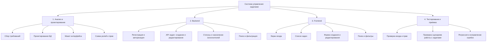
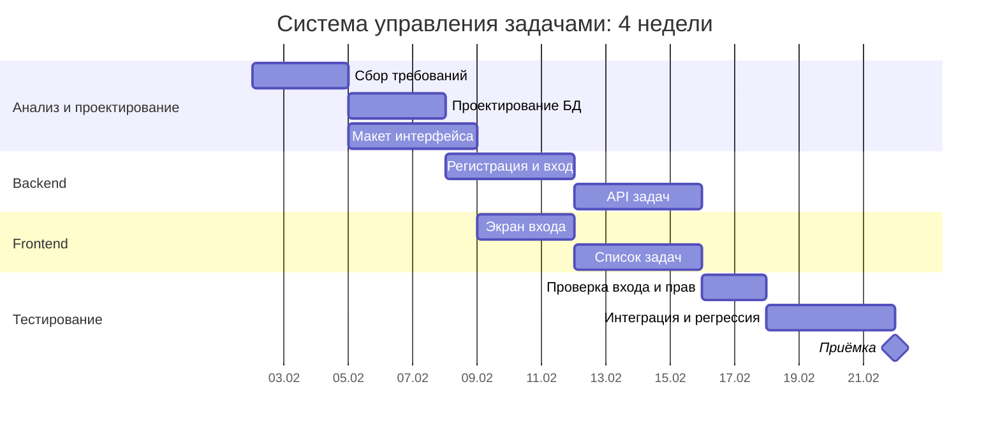

# Пара 4
## Практическая работа 1

«Разработать систему управления задачами»

##WBS проекта

в этой схеме Анализ и проектирование идут ПЕРВЫМИ, потому что от них зависят обе ветки разработки! 
Backend и Frontend после этого можно вести параллельно - интерфейс опирается на макет и согласованный формат API, а не на готовый код
Тестирование начинается не в конце, а по мере готовности

## Контрольные точки

| № | Контрольная точка | Когда | Результат |
|---|---|---|---|
| 1 | Требования согласованы | конец 1 недели | Список функций и ролей, макет интерфейса |
| 2 | База данных готова | середина 2 недели | Схема БД, миграции, тестовые данные |
| 3 | Основная функциональность работает | конец 3-й недели | Задачи создаются, редактируются, меняют статус |
| 4 | Тестирование завершено | конец 4 недели | Пройдены основные сценарии, критичных ошибок нет |
| 5 | Продукт передан заказчику | конец 4 недели | Развёрнутая система и краткая инструкция |

## Зависимости

- Проектирование БД - после сбора требований: иначе схема будет реворкаться
- Макет интерфейса - после требований, параллельно с БД этим займутся разные люди и будут разные доки
- Backend - после БД и согласованного формата API
- Frontend - после макета, подключать к реальному API можно, когда он появится
- Интеграционное тестирование - только после готовности API и интерфейса; проверка входа и прав - раньше, сразу как есть что проверять, работать будем по принципу КТТС(Как Только Так Сразу)
- Внедрение - после приёмки.

##диаграмма Ганта

Даты условные, четыре недели начиная с понедельника

