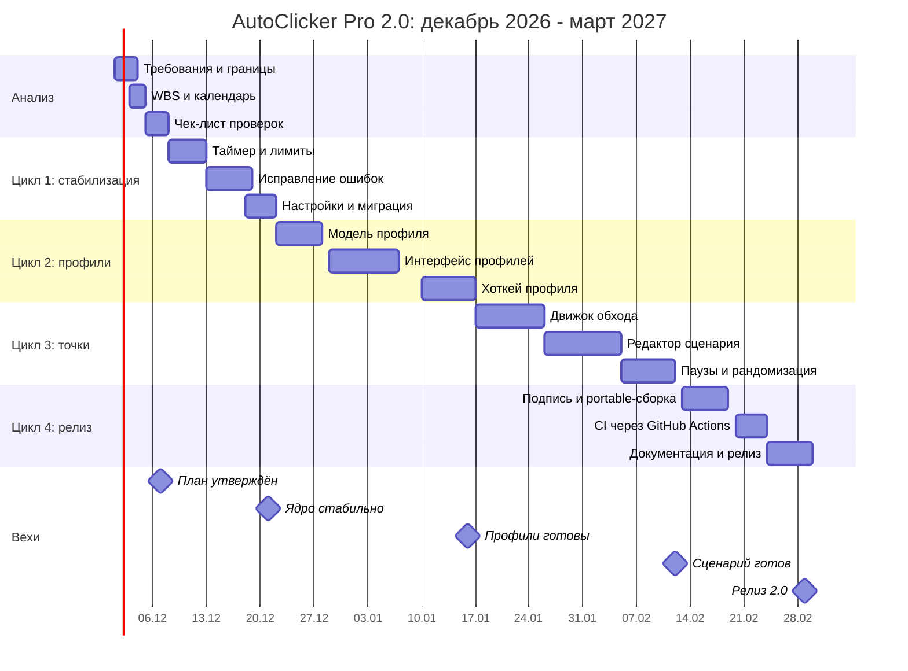

# Пара 04. Планирование программного проекта
## Практическая работа №2. Календарный план собственного проекта

**AutoClicker Pro** - <https://github.com/AlexMDLL/AutoClicker>. 
Цель - релиз 2.0 к 1 марта 2027 года(по сути так то бы он готовый но для задания сделаю так)
Работаю над проектом 3-5 часов в неделю и один, поэтому задачи идут строго последовательно: параллелить нечем, кроме документации и тестов.

## Задачи и трудоёмкость

| № | Этап | Задача | Результат | Ч | Кто | Даты |
|---|---|---|---|---|---|---|
| 1 | Анализ | Уточнить требования и границы | Список задач на 2.0 из issues | 2 | РП/аналитик | 01.12-03.12 |
| 2 | Анализ | Собрать WBS и календарный план | Этот документ | 2 | РП | 03.12-05.12 |
| 3 | Анализ | Чек-лист регрессионных проверок | 12-15 пунктов, прогон по 10 минут | 2 | тестировщик | 05.12-07.12 |
| 4 | Цикл 1 | Ревизия точного таймера и лимитов | Корректный интервал 1 мс и лимиты | 4 | разработчик | 08.12-13.12 |
| 5 | Цикл 1 | Исправить ошибки из issues | Закрыты критичные баги | 5 | разработчик | 13.12-18.12 |
| 6 | Цикл 1 | Автосохранение и миграция настроек | Настройки не теряются при обновлении | 3 | разработчик | 18.12-21.12 |
| 7 | Цикл 2 | Модель профиля и хранение в JSON | Несколько наборов настроек | 3 | разработчик | 22.12-28.12 |
| 8 | Цикл 2 | Интерфейс управления профилями | Создание, переименование, удаление | 4 | разработчик | 29.12-09.01 |
| 9 | Цикл 2 | Хоткей переключения профиля | Смена сценария одной клавишей | 3 | разработчик | 10.01-16.01 |
| 10 | Цикл 3 | Движок точек и порядка обхода | Сценарий из точек работает | 5 | разработчик | 17.01-25.01 |
| 11 | Цикл 3 | Редактор сценария в интерфейсе | Список точек, перетаскивание, порядок | 4 | разработчик | 26.01-04.02 |
| 12 | Цикл 3 | Паузы и рандомизация в сценарии | Задержка на каждую точку | 3 | разработчик | 05.02-12.02 |
| 13 | Цикл 4 | Подпись `.exe` и portable-сборка | Запуск без предупреждений SmartScreen | 4 | разработчик | 13.02-19.02 |
| 14 | Цикл 4 | Сборка через GitHub Actions | Автосборка на каждый тег | 2 | разработчик | 20.02-23.02 |
| 15 | Цикл 4 | Документация и релиз 2.0 | README, changelog, опубликованный релиз | 3 | РП | 24.02-01.03 |

Итого где то 49 часов 
При 4 часах в неделю это 12 недель: запас - около одной недели которая уйдет на доработки и прочую мелоч

## Зависимости

- Задачи 4-15 - после согласованных требований (задача 1): без списка функций непонятно, что вообще доделывать.
- Профили (7) - после стабилизации ядра (4-5): нет смысла сохранять настройки движка, в котором ещё ловятся баги.
- Сценарий точек (10) - после профилей (7): сценарий должен сохраняться в профиле, а не отдельным файлом.
- Интерфейс профилей (8) и редактор сценария (11) - после своих моделей данных, иначе придётся переделывать разметку.
- Подпись и сборка (13-14) - после того как код перестал меняться каждый день.
- Документация (15) и чек-лист (3) - параллельно разработке: чек-лист пишется по ходу, а README можно обновлять с каждой версией.

## Контрольные точки

| № | Контрольная точка | Дата | Результат |
|---|---|---|---|
| M1 | План утверждён | 07.12.2026 | WBS, календарь и чек-лист проверок готовы |
| M2 | Стабильное ядро | 21.12.2026 | Версия 1.1: 30 минут кликов без сбоев |
| M3 | Профили готовы | 16.01.2027 | Версия 1.2: переключение сценариев работает |
| M4 | Сценарий точек готов | 12.02.2027 | Версия 1.3: 5 точек обходятся в заданном порядке |
| M5 | Релиз 2.0 | 01.03.2027 | Подписанный `.exe`, CI, обновлённый README |

## Диаграмма Ганта

