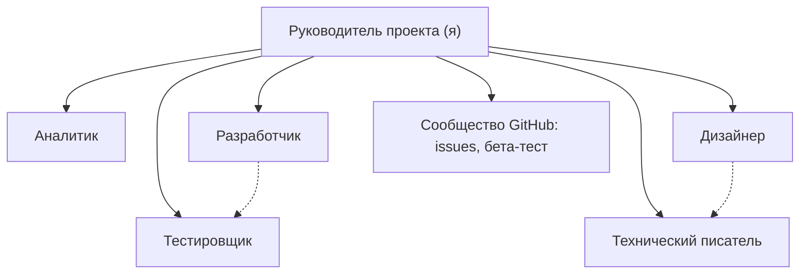

# Пара 5
## Практическая работа 2

Проект - **AutoClicker Pro**: <https://github.com/AlexMDLL/AutoClicker>. У меня тут по сути RP я по очереди разный человек в одном обличии и это труднро
Руководитель проекта тоже я, в дальнейшем РП
## Роли и обязанности

| Роль | Обязанности | Что решает сам | Что согласует с РП |
|---|---|---|---|
| **Руководитель проекта**ь | План, приоритеты, объём релиза, разбор issues, публикация версий | Порядок работ и объём цикла | - (это и есть РП) |
| **Аналитик** | Требования, границы 2.0, приёмка идей, постановка задач себе | Как сформулировать задачу | Включение новой функции в релиз |
| **Разработчик** | Код на C#/WPF, Win32-вызовы, таймер, хранение настроек | Внутренняя архитектура и стиль кода | Смена внешнего поведения и настроек по умолчанию |
| **Тестировщик** | Чек-лист, тест трёх режимов, регрессия, баг-репорты | Заведение бага и его приоритет | Считать ли баг блокирующим релиз |
| **Дизайнер интерфейса** | Темы, раскладки, иконки, аккуратность экранов | Цвета, отступы, иконки | Изменение структуры экранов |
| **Технический писатель** | README, changelog, локализация RU/EN, справка | Формулировки текстов | README про сроки, функции и прочее |

## Кого можно совмещать

- **РП + аналитик** я бы совместил, работы у  них не особо отличаются друг от друга
- **Разработчик + тестировщик** - Тут уже более опасненько становится потому что трудно различить когда сам пишешь и тестируешь что где не так, вроде все работает а потом уже не факт
- **Дизайнер + писатель** - тоже самое как и с РП и аналитиком, разницы особой нету, и там и там работа над конкретными элементами, а не по всему пректу
Если появится второй человек, первым делом отдам тестирование и техписание - там больше всего пользы от независимого взгляда.

## Структура

Пунктиром - совмещение ролей одним человеком, сообщество - это внешние "консультируемые": подсказывают идеи и находят баги, но решений за меня не принимают.
